<p align="center">
  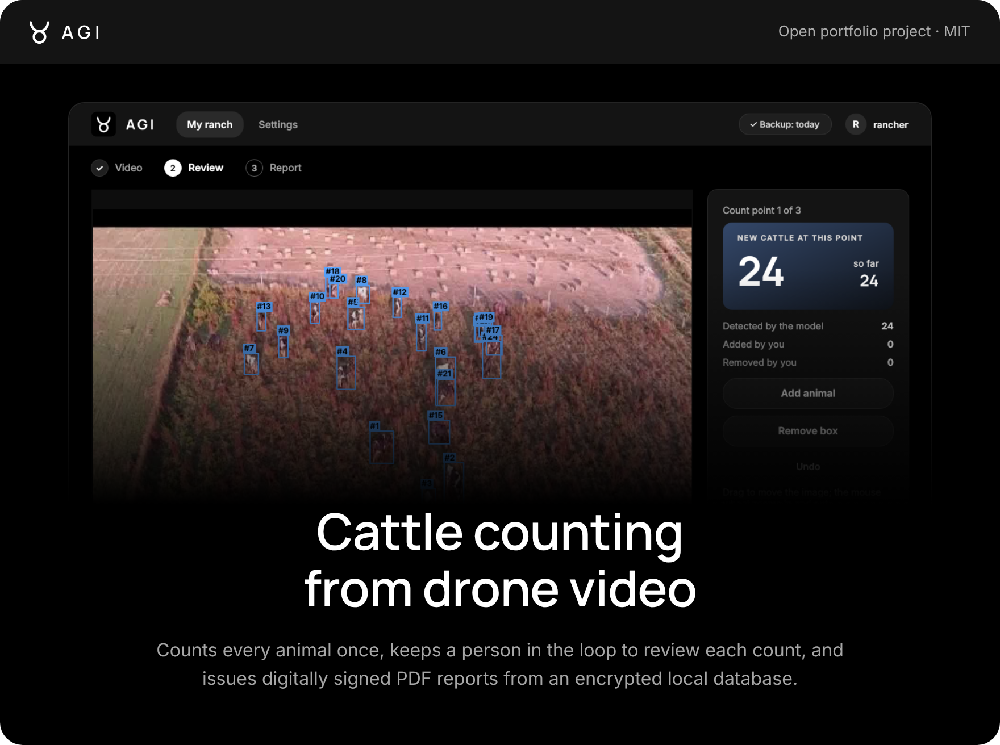
</p>

<p align="center">
  <a href="#how-it-works">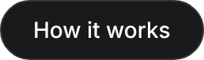</a>
  <a href="#results">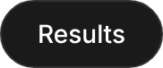</a>
  <a href="#showcase">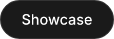</a>
  <a href="#security-design">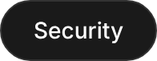</a>
  <a href="#faq">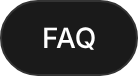</a>
  <a href="#run-it">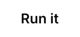</a>
</p>

<p align="center">
  <a href="https://github.com/JulianRodriguezETH/agi/actions/workflows/windows.yml"></a>
  
  
</p>

> [!NOTE]
> **Status: open portfolio project.** AGI was designed for ranches in Arauca, Colombia, but drone
> flights aren't allowed in that area, so it has **never been tested in the field**. Everything
> below was tested on real aerial photos (the WAID dataset) and on simulated flights built from
> them.

<p align="center">
  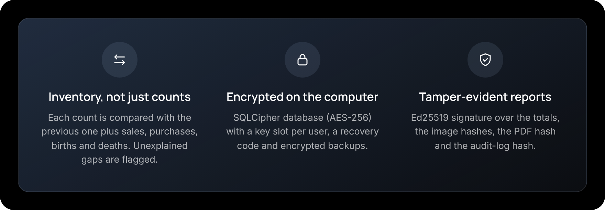
</p>

<h2 align="center" id="how-it-works">How it works</h2>

<p align="center">
  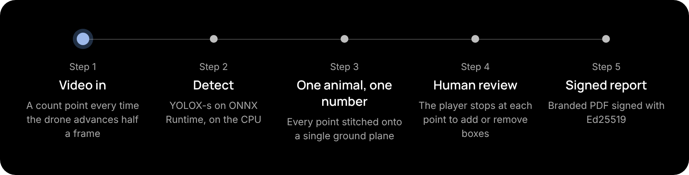
</p>

1. **Video in.** Choose one or more videos of the same flight. AGI measures how far the ground
   moves (phase correlation, ~10×/s) and takes a *count point* every time the drone has advanced
   half a frame.
2. **Detect.** A YOLOX‑s detector (ONNX Runtime, CPU) finds every animal in each count point,
   tiling large frames and merging duplicate boxes across tiles.
3. **One animal, one number.** All count points are stitched onto a single ground plane (ORB
   features + RANSAC similarity, with a normalized cross‑correlation check on the overlap). Each
   animal gets a fixed ID the first time it is seen; if it shows up again in another point it keeps
   its ID and is **not added again**. Reversed flight lines and separate videos of the same paddock
   are joined too.
4. **Human review.** A video player stops at each count point with boxes drawn. The person adds or
   removes boxes; repeats are shown dotted with their original number.
5. **Signed report.** The final count, a count map (each animal once, where it was seen), the
   per‑point table and inventory reconciliation go into a PDF signed with Ed25519.
   `verificar.py` checks that neither the PDF, the figures nor the images changed.

<h2 align="center" id="results">Results</h2>

<p align="center">
  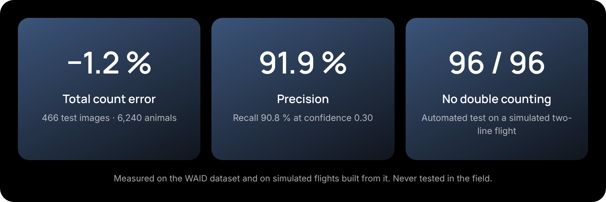
</p>

**Detector** (YOLOX‑s fine‑tuned on the 3,267 cattle images of WAID; confidence 0.30):

| Test | Real | Counted | Total error | Precision | Recall |
|---|---|---|---|---|---|
| 466 test images (640 px) | 6,240 | 6,163 | −1.2 % | 91.9 % | 90.8 % |
| 20 large images (1920 px, tiled) | 2,164 | 2,181 | +0.8 % | 91.9 % | 92.6 % |

Test images come from the same flights as training images, so these numbers are optimistic.

**No double counting** (simulated flights over a real aerial photo with 60 hand‑labelled animals):
two overlapping videos, the second rotated 180°, gave **62**; one video including the turn gave
**59**. Naively summing every count point gave **154**. The automated app test reproduces this on
another paddock: 96 animals, AGI counts 96.

<h2 align="center" id="showcase">Showcase</h2>

<table>
  <tr>
    <td width="50%"><a href="docs/img/04_revisar.png"></a></td>
    <td width="50%"><a href="docs/img/05_ya_contadas.png">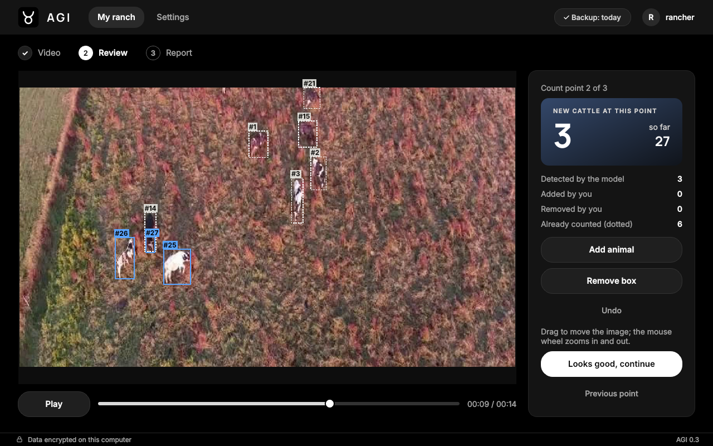</a></td>
  </tr>
  <tr>
    <td valign="top"><b>Review every count point</b><br>The player stops at each point with the boxes drawn; a person adds or removes them.</td>
    <td valign="top"><b>Counted once</b><br>Animals already counted at another point are dotted, keep their number and don't add up.</td>
  </tr>
  <tr>
    <td><a href="docs/img/06_reporte.png"></a></td>
    <td><a href="docs/img/02_finca.png"></a></td>
  </tr>
  <tr>
    <td valign="top"><b>Count report</b><br>Total, review summary, reconciliation, findings and the count map before signing.</td>
    <td valign="top"><b>Ranch page</b><br>Last count, history per count or per month, findings, counts and movements.</td>
  </tr>
  <tr>
    <td><a href="docs/img/09_pdf.png">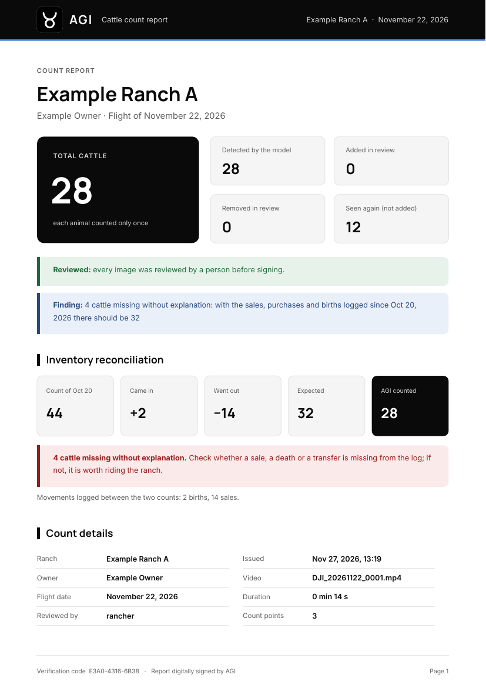</a></td>
    <td><a href="docs/img/10_mapa.jpg">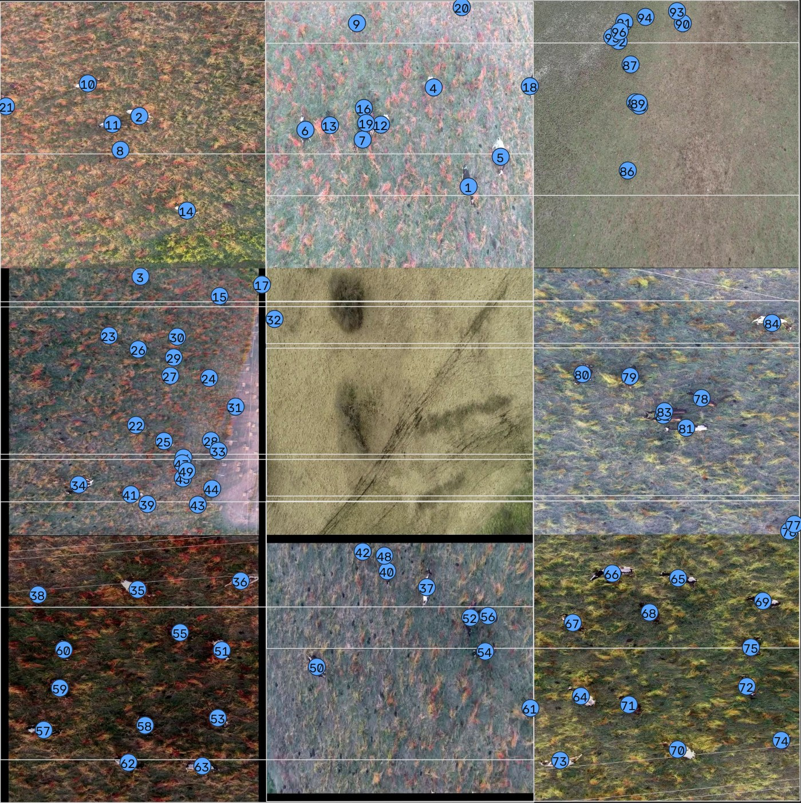</a></td>
  </tr>
  <tr>
    <td valign="top"><b>Signed PDF report</b><br>What the owner keeps: the count, the reconciliation and a verification code.</td>
    <td valign="top"><b>Count map</b><br>Every animal once, with its number, where it was seen across the flight.</td>
  </tr>
</table>

<h2 align="center" id="inventory-not-just-counts">Inventory, not just counts</h2>

- **Reconciliation.** The owner logs sales, purchases, births and deaths. AGI compares each count
  with *previous count + in − out* and flags animals missing without explanation.
- **Paddocks.** A count can cover one paddock; paddocks counted on the same day add up.
- **History and export.** Per‑count and monthly charts, Excel export (summary, counts, movements,
  reconciliation, monthly close).

<table>
  <tr>
    <td width="58%"><a href="docs/img/03_cuadre.png">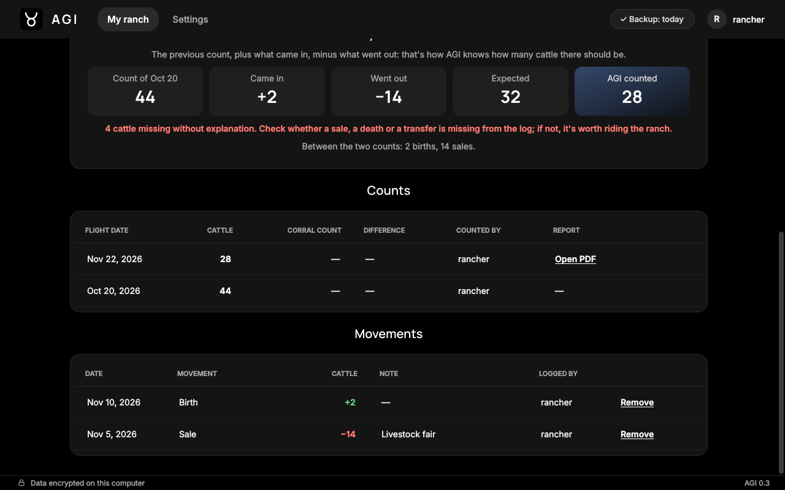</a></td>
    <td width="42%"><a href="docs/img/07_movimiento.png">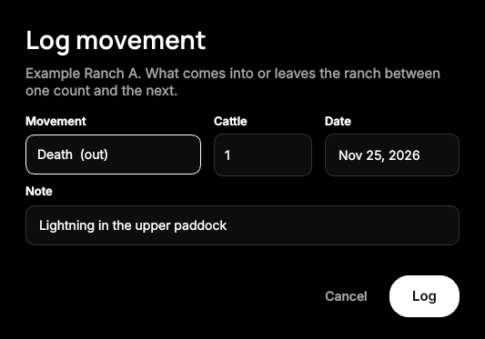</a></td>
  </tr>
</table>

<h2 align="center" id="security-design">Security design</h2>

| | |
|---|---|
| **Encrypted database** | SQLCipher (AES‑256). The DB key is random; each user's slot wraps it with their password (scrypt + AES‑GCM, X25519 envelopes). A recovery code is one more slot. |
| **Users and roles** | Admin / operator. Deactivating a user **rotates the DB key** in three crash‑safe steps. |
| **Tamper‑evident log** | Every action is chained to the previous one by hash; editing or deleting a row is detected. |
| **Signed reports** | Ed25519 over a canonical manifest (totals, per‑image hashes, PDF hash, log hash). |
| **Brute force** | 5 free attempts, then 30 s doubling up to 15 min; weak, common and sequential passwords are rejected. |
| **Backups** | Full encrypted copy (DB, keys, signed PDFs) to a USB or synced folder, verified after writing, last 10 kept. Restore on a new computer from the first screen. |
| **Robustness** | Auto‑lock after 10 min idle, single instance per data folder, model integrity check (SHA‑256), crash log, damaged images skipped and logged. |

Not audited by a security professional. The signature proves a report wasn't changed after it was
issued, not where or when the video was recorded.

<p align="center">
  <a href="docs/img/01_crear_cuenta.png">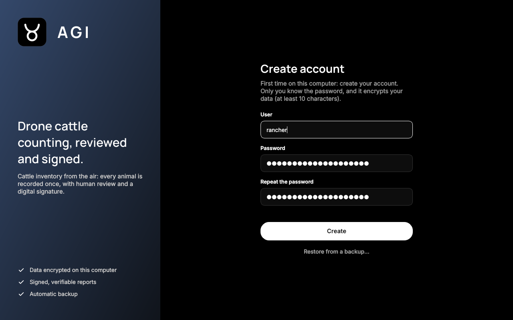</a>
  <a href="docs/img/08_respaldo.png">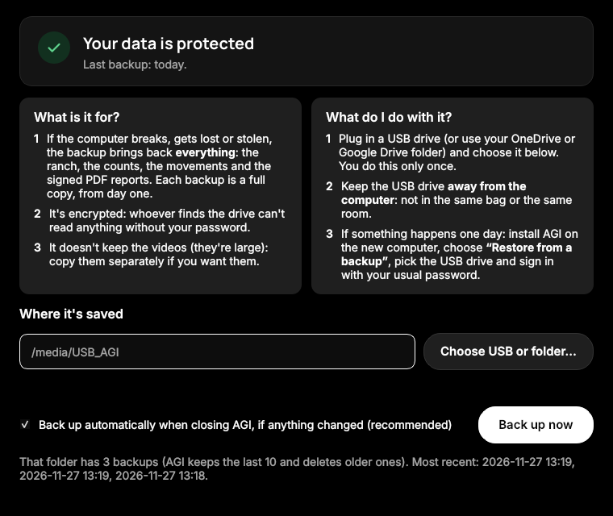</a>
</p>

<h2 align="center" id="run-it">Run it</h2>

```
python -m venv .venv
.venv\Scripts\pip install -r requirements.txt      # Windows (source .venv/bin/activate elsewhere)
.venv\Scripts\python agi.py
```

On Windows, `probar_en_windows.bat` sets everything up, runs the tests and opens the app with
separate test data. `armar_instalador.bat` builds the installer locally (needs Inno Setup 6).

Counting photos from the command line:

```
python contar.py --modelo modelos/reses_s.onnx --entrada ejemplos --salida resultados
```

Verifying a signed report (a sample is in `ejemplos_app/`):

```
python verificar.py ejemplos_app/reporte_ejemplo.pdf --llave ejemplos_app/llave_publica.pem
```

### Tests

```
python probar_seguridad.py   # 90+ checks: crypto, roles, log, signatures, backups, reconciliation
python probar_app.py         # drives the real UI offscreen: counting from video, review, PDF, lock…
```

The [GitHub Actions workflow](.github/workflows/windows.yml) runs both on Windows x64, builds
`AGI.exe` with PyInstaller, runs a self‑test of the packaged app (`AGI.exe --autoprueba`) and
produces an installer with Inno Setup.

### Project layout

| File | |
|---|---|
| `agi.py` | Desktop app (PySide6): pages, review player, report step, dark theme |
| `piezas.py` | Shared UI pieces: sign‑in, photo viewer, background detection, users, backup, palette |
| `vuelo.py` | Video → count points, stitching onto one plane, fixed IDs, count map |
| `contar.py` | Detector (ONNX Runtime): tiling, box merging, drawing |
| `datos.py` | Encrypted database, users, log, counts, movements, reconciliation, backups |
| `seguridad.py` | Key slots, password hardening, signatures, envelopes |
| `reporte.py` | Signed PDF report |
| `verificar.py` | Verifies a signed report from the command line |
| `excel.py` | Excel export |
| `termica.py` | Experimental: hot‑spot detection in DJI thermal photos, geolocated and grouped into herd / isolated animals (needs the DJI Thermal SDK) |
| `entrenar.py`, `exportar.py`, `evaluar.py` | Training, ONNX export and evaluation |
| `icono/` | Logo: `agi_marca.svg` is the source, `logo.py` regenerates the icon and logo files |

The interface, reports and exports are in English; code identifiers and comments are in Spanish.

<h2 align="center" id="faq">FAQ</h2>

<details>
<summary><b>Has AGI been used on a real ranch?</b></summary>
<br>
No. It has never been tested with real drone video or in the field. All figures come from the WAID
dataset and from simulated flights built from its photos.
</details>

<details>
<summary><b>Can the same animal still be counted twice?</b></summary>
<br>
Yes, in one case: an animal that walks a lot between two passes can be counted twice. Animals that
stay roughly in place keep their number when they show up again at another count point.
</details>

<details>
<summary><b>What happens over very uniform pasture?</b></summary>
<br>
Pasture with no features may not stitch. Within one flight line AGI falls back to the measured
ground motion; if a part of the flight can't be joined to the rest, the report step warns about it.
</details>

<details>
<summary><b>Does it need a GPU?</b></summary>
<br>
No. The detector runs on the CPU with ONNX Runtime.
</details>

<details>
<summary><b>What does the signature on a report prove?</b></summary>
<br>
That the PDF, the figures and the images were not changed after the report was issued. It does not
prove where or when the video was recorded, or that the count is right.
</details>

<details>
<summary><b>Has the security design been audited?</b></summary>
<br>
No. It has not been audited by a security professional.
</details>

<details>
<summary><b>Does it run on Windows?</b></summary>
<br>
It is built and tested on Windows x64 in CI, which also produces the installer. It has not been
tested on a physical Windows laptop yet.
</details>

<h2 align="center" id="resources">Resources</h2>

<p align="center">
  <a href="ejemplos_app/reporte_ejemplo.pdf">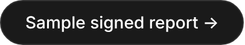</a>
  <a href="https://github.com/JulianRodriguezETH/agi/actions/workflows/windows.yml">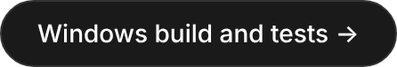</a>
  <a href="https://github.com/xiaohuicui/WAID">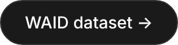</a>
  <a href="https://github.com/Megvii-BaseDetection/YOLOX">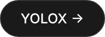</a>
</p>

### Credits

- **Detector:** [YOLOX](https://github.com/Megvii-BaseDetection/YOLOX) (Apache 2.0), starting from the
  official COCO weights.
- **Data:** WAID — *Mou, C., Liu, T., Zhu, C., Cui, X. (2023). WAID: A Large‑Scale Dataset for Wildlife
  Detection with Drones. Applied Sciences 13(18), 10397.* The example images in `ejemplos/` and the
  screenshots come from WAID. The dataset was published for research; the trained weights in
  `modelos/` inherit its terms.
- **Font:** Manrope (SIL Open Font License, in `fuentes/`).

### License

<sub>Code under the <a href="LICENSE">MIT License</a>. The model weights and the WAID‑derived images are not covered by
the MIT license; see Credits.</sub>
