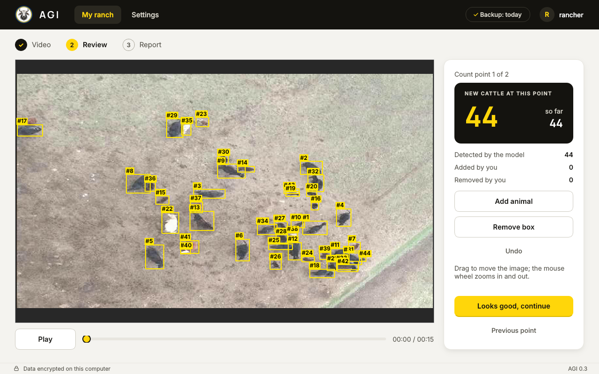
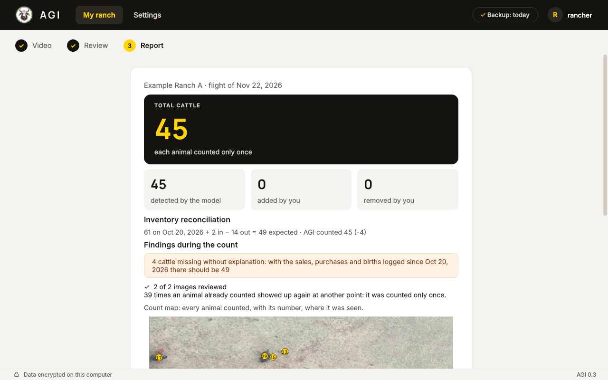
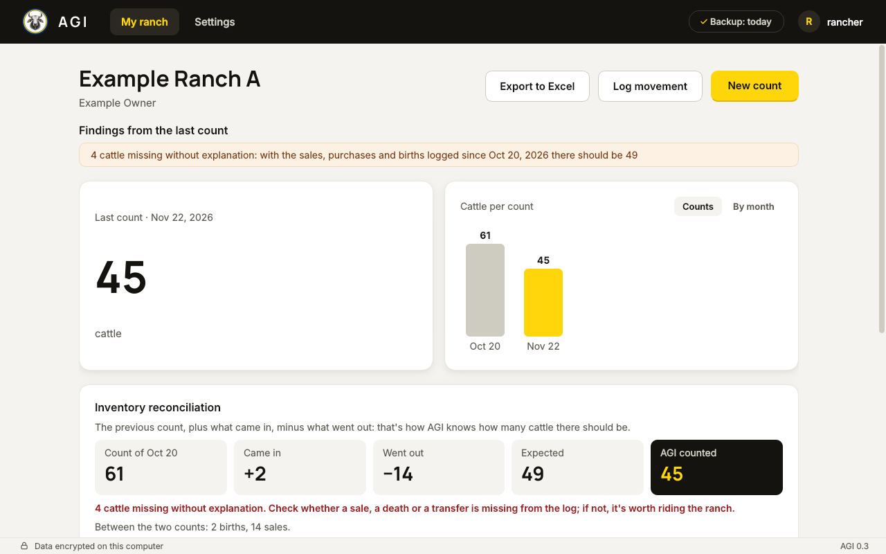

# AGI · Cattle counting from drone video

[](https://github.com/JulianRodriguezETH/agi/actions/workflows/windows.yml)


A desktop app that counts cattle in drone video **without counting the same animal twice**, keeps a
human in the loop to review every count, and issues **digitally signed PDF reports** from an
**encrypted local database**.

> **Status: open portfolio project.** It was designed for ranches in Arauca, Colombia, but drone
> flights aren't allowed in that area, so it has **never been tested in the field**. Everything
> below was tested on real aerial photos (the WAID dataset) and on simulated flights built from
> them.



## What it does

1. **Video in.** Choose one or more videos of the same flight. AGI measures how far the ground
   moves (phase correlation, ~10×/s) and takes a *count point* every time the drone has advanced
   half a frame.
2. **Detect.** A YOLOX‑s detector (ONNX Runtime, CPU) finds every animal in each count point,
   tiling large frames and merging duplicate boxes across tiles.
3. **One animal, one number.** All count points are stitched onto a single ground plane (ORB
   features + RANSAC similarity, with a normalized cross‑correlation check on the overlap). Each
   animal gets a fixed ID the first time it is seen; if it shows up again in another point it keeps
   its ID and is **not added again**. Reversed flight lines and separate videos of the same paddock
   are joined too.
4. **Human review.** A video player stops at each count point with boxes drawn. The person adds or
   removes boxes; repeats are shown dotted with their original number.
5. **Signed report.** The final count, a count map (each animal once, where it was seen), the
   per‑point table and inventory reconciliation go into a branded PDF, signed with Ed25519.
   `verificar.py` checks that neither the PDF, the figures nor the images changed.

| | |
|---|---|
|  |  |
| *Animals already counted in another point keep their number and don't add up* | *Step 3: total, findings, reconciliation and count map* |
|  |  |
| *Farm page: last count, history, findings* | *Signed PDF report* |

## Results

**Detector** (YOLOX‑s fine‑tuned on the 3,267 cattle images of WAID; confidence 0.30):

| Test | Real | Counted | Total error | Precision | Recall |
|---|---|---|---|---|---|
| 466 test images (640 px) | 6,240 | 6,163 | −1.2 % | 91.9 % | 90.8 % |
| 20 large images (1920 px, tiled) | 2,164 | 2,181 | +0.8 % | 91.9 % | 92.6 % |

Test images come from the same flights as training images, so these numbers are optimistic.

**No double counting** (simulated flights over a real aerial photo with 60 hand‑labelled animals):
two overlapping videos, the second rotated 180°, gave **62**; one video including the turn gave
**59**. Naively summing every count point gave **154**. The automated app test reproduces this on
another paddock: 96 animals, AGI counts 96.

## Inventory, not just counts

- **Reconciliation.** The owner logs sales, purchases, births and deaths. AGI compares each count
  with *previous count + in − out* and flags animals missing without explanation.
- **Paddocks.** A count can cover one paddock; paddocks counted on the same day add up.
- **History and export.** Per‑count and monthly charts, Excel export (summary, counts, movements,
  reconciliation, monthly close).

| | |
|---|---|
|  |  |

## Security design

| | |
|---|---|
| **Encrypted database** | SQLCipher (AES‑256). The DB key is random; each user's slot wraps it with their password (scrypt + AES‑GCM, X25519 envelopes). A recovery code is one more slot. |
| **Users and roles** | Admin / operator. Deactivating a user **rotates the DB key** in three crash‑safe steps. |
| **Tamper‑evident log** | Every action is chained to the previous one by hash; editing or deleting a row is detected. |
| **Signed reports** | Ed25519 over a canonical manifest (totals, per‑image hashes, PDF hash, log hash). |
| **Brute force** | 5 free attempts, then 30 s doubling up to 15 min; weak, common and sequential passwords are rejected. |
| **Backups** | Full encrypted copy (DB, keys, signed PDFs) to a USB or synced folder, verified after writing, last 10 kept. Restore on a new computer from the first screen. |
| **Robustness** | Auto‑lock after 10 min idle, single instance per data folder, model integrity check (SHA‑256), crash log, damaged images skipped and logged. |

Not audited by a security professional. The signature proves a report wasn't changed after it was
issued, not where or when the video was recorded.

## Tests

```
python probar_seguridad.py   # 94 checks: crypto, roles, log, signatures, backups, reconciliation
python probar_app.py         # drives the real UI offscreen: counting from video, review, PDF, lock…
```

The [GitHub Actions workflow](.github/workflows/windows.yml) runs both on Windows x64, builds
`AGI.exe` with PyInstaller, runs a self‑test of the packaged app (`AGI.exe --autoprueba`) and
produces an installer with Inno Setup.

## Run it

```
python -m venv .venv
.venv\Scripts\pip install -r requirements.txt      # Windows (source .venv/bin/activate elsewhere)
.venv\Scripts\python agi.py
```

On Windows, `probar_en_windows.bat` sets everything up, runs the tests and opens the app with
separate test data. `armar_instalador.bat` builds the installer locally (needs Inno Setup 6).

Counting photos from the command line:

```
python contar.py --modelo modelos/reses_s.onnx --entrada ejemplos --salida resultados
```

## Project layout

| File | |
|---|---|
| `agi.py` | Desktop app (PySide6): pages, review player, report step |
| `vuelo.py` | Video → count points, stitching onto one plane, fixed IDs, count map |
| `contar.py` | Detector (ONNX Runtime): tiling, box merging, drawing |
| `datos.py` | Encrypted database, users, log, counts, movements, reconciliation, backups |
| `seguridad.py` | Key slots, password hardening, signatures, envelopes |
| `reporte.py` | Signed PDF report |
| `verificar.py` | Verifies a signed report from the command line |
| `excel.py` | Excel export |
| `termica.py` | Experimental: hot‑spot detection in DJI thermal photos, geolocated and grouped into herd / isolated animals (needs the DJI Thermal SDK) |
| `entrenar.py`, `exportar.py`, `evaluar.py` | Training, ONNX export and evaluation |

The interface, reports and exports are in English; code identifiers and comments are in Spanish.

## Limitations

- Never tested with real drone video or in the field.
- An animal that walks a lot between passes can be counted twice.
- Very uniform pasture (no features) may not stitch; within one line AGI falls back to the measured
  ground motion.
- Not tested on a physical Windows laptop yet (only in CI).

## Credits

- **Detector:** [YOLOX](https://github.com/Megvii-BaseDetection/YOLOX) (Apache 2.0), starting from the
  official COCO weights.
- **Data:** WAID — *Mou, C., Liu, T., Zhu, C., Cui, X. (2023). WAID: A Large‑Scale Dataset for Wildlife
  Detection with Drones. Applied Sciences 13(18), 10397.* The example images in `ejemplos/` and the
  screenshots come from WAID. The dataset was published for research; the trained weights in
  `modelos/` inherit its terms.
- **Font:** Manrope (SIL Open Font License, in `fuentes/`).
- The bull illustration in the logo was generated with Kling.

## License

Code under the [MIT License](LICENSE). The model weights and the WAID‑derived images are not covered by
the MIT license; see Credits.
